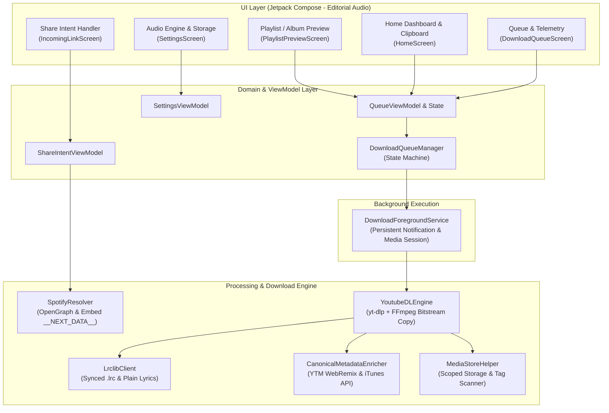

# Spotdl Android — Comprehensive Implementation Plan & Tracker

> **Project:** Spotdl Android App  
> **Source Repository:** `/home/kishanvishwakarma/AndroidStudioProjects/Spotdl`  
> **Reference Engine:** `/home/kishanvishwakarma/Documents/music_downloader_using_ytdlp` (`ymusic`)  
> **UI Design System:** `/home/kishanvishwakarma/Downloads/stitch_spotdl_premium_android_music_app` ("Editorial Audio")  
> **Target Platform:** Android 11+ (minSdk 30, targetSdk 37), Jetpack Compose, Kotlin 2.2  
> **Current Status:** Phase 1 — Initialization & Planning  

---

## Architecture Overview

---

## Implementation Phases & Progress Tracker

- [x] **Phase 1: Project Setup, Dependencies & System Configuration**
  - [x] Configure `gradle/libs.versions.toml` with required libraries and plugins.
  - [x] Update `app/build.gradle.kts` (NDK ABI filters, packaging options, Java 17/11, dependencies).
  - [x] Configure `settings.gradle.kts` with JitPack repository if needed.
  - [x] Update `AndroidManifest.xml` with permissions (`INTERNET`, `FOREGROUND_SERVICE`, `POST_NOTIFICATIONS`, `WAKE_LOCK`).
  - [x] Add `ACTION_SEND` Intent Filter for text/plain sharing from Spotify and YouTube Music.
  - [x] Create `SpotdlApplication` class to initialize `YoutubeDL` and `FFmpeg` runtimes.

- [x] **Phase 2: "Editorial Audio" Design System & Jetpack Compose Theme**
  - [x] Define color tokens in `Color.kt` from Stitch `DESIGN.md` (warm canvas `#FAF9F5`, surface `#FFFFFF`, olive `#4E5B44`, tertiary `#3C5F48`).
  - [x] Add dark mode theme variant (tactile OLED charcoal `#121311`).
  - [x] Configure typography in `Type.kt` (Plus Jakarta Sans for headlines, Inter for numbers and tabular telemetry).
  - [x] Implement reusable Stitch components:
    - [x] `KeylineCard`: Surface elevation via 1px `#EAE9E3` border with zero drop shadow.
    - [x] `StatusPill`: High-contrast pill chips for audio formats (`320k`, `FLAC`, `In Library`).
    - [x] `LinearGauge`: Rounded progress bar with smooth buffer animation.
    - [x] `SegmentedStorageBar`: Multi-color partitioned storage gauge for Settings.
    - [x] `TrackRowItem`: Standard row with artwork, title, artist, and action icon.

- [x] **Phase 3: Pure Kotlin Metadata Resolution Engine (Port of `ymusic`)**
  - [x] Create domain models: `TrackMetadata`, `CollectionMetadata`, `DownloadItem`, `DownloadStatus`, `AudioFormatPreference`.
  - [x] Implement `SpotifyResolver`:
    - [x] Track resolution via OpenGraph HTML scraper with `facebookexternalhit/1.1` User-Agent.
    - [x] Album & Playlist resolution via public embed endpoint (`https://open.spotify.com/embed/{type}/{id}`) parsing `<script id="__NEXT_DATA__">`.
    - [x] Per-track master artwork preservation for playlists.
  - [x] Implement `LrclibClient`:
    - [x] Title/artist query sanitization (stripping `[Official Video]`, `ft.`, remastered noise).
    - [x] Exact match endpoint (`/api/get`) with search fallback (`/api/search`).
    - [x] Millisecond synced `.lrc` and plain lyrics support.
  - [x] Implement `CanonicalMetadataEnricher`:
    - [x] YouTube Music `WEB_REMIX` client (`https://music.youtube.com/youtubei/v1/player`) to fetch 1:1 master square artwork (up to 1400x1400) and reject 16:9 widescreen video frames.
    - [x] iTunes Search API client (`https://itunes.apple.com/search`) fallback for missing tags (album, track number, disc, release year, genre).

- [x] **Phase 4: YouTube Audio Extraction & Lossless Remux Engine**
  - [x] Implement `YoutubeDLEngine`:
    - [x] Query formatting targeting official studio masters: `"{artist} - {title} Topic"` and `"{artist} {title} Audio"`.
    - [x] Target stream selector: `141/251/bestaudio[ext=webm]/140/bestaudio/best`.
    - [x] Zero audio transcoding via `-c:a copy` into native `.opus` or `.m4a`.
    - [x] Tag embedding with metadata (title, artist, album, date, track number, genre).
    - [x] Companion `.lrc` lyrics file generation in the target directory.
  - [x] Implement `MediaStoreHelper` & Library Organizer:
    - [x] Directory formatting: `Music/spotdl/<Artist>/<Album> (<Year>)/01 - <Title>.<ext>` or `Music/spotdl/<Playlist>/...`.
    - [x] Android 11+ Scoped Storage compliance (`Environment.DIRECTORY_MUSIC`).
    - [x] Automatic `MediaScannerConnection` scan trigger so downloaded songs appear instantly in system music players.

- [x] **Phase 5: Background Execution, Queue Architecture & Service**
  - [x] Implement `DownloadQueueManager`:
    - [x] Finite State Machine for downloads: `Queued` -> `Resolving` -> `Downloading` -> `Tagging` -> `Completed` / `Failed` / `Paused`.
    - [x] Batch tracking (active count, speed calculation in MB/s, ETA calculation, total bytes).
    - [x] Queue actions: Pause Batch, Resume Batch, Cancel Track, Retry Failed, Clear Completed.
  - [x] Implement `DownloadForegroundService`:
    - [x] Foreground service with `FOREGROUND_SERVICE_TYPE_DATA_SYNC`.
    - [x] Dynamic notification with progress bar, active song title, download speed, and Pause/Cancel actions.
    - [x] Notification channels setup for downloads and batch completion alerts.

- [x] **Phase 6: Jetpack Compose Screens (Google Stitch UI)**
  - [x] **Screen 1: Incoming Link Ingestion (`IncomingLinkScreen.kt`)**
    - [x] Intercept shared URL from `Intent.ACTION_SEND` (or pasted URL).
    - [x] Spotify source header badge with active handshake pulsing indicator.
    - [x] Concentric radar pulse rings with rotating scanner beam animation.
    - [x] Discovered telemetry ribbon and sequential 3-stage pipeline status ("Reading shared link" -> "Fetching music details" -> "Checking track availability").
    - [x] Auto-transition to Playlist Preview upon metadata resolution.
  - [x] **Screen 2: Playlist / Album Preview (`PlaylistPreviewScreen.kt`)**
    - [x] Square master cover art, playlist title, curator, duration, and track count.
    - [x] 4-column availability summary banner (Total, Available, In Library, Restricted).
    - [x] Granular tracklist with individual checkboxes, format badges (`320k`, `FLAC`), and "Select/Deselect All" button.
    - [x] Sticky bottom action bar with live dynamic track count, storage projection (`Approx. ~124.6 MB total`), and "Download playlist" CTA.
  - [x] **Screen 3: Download Queue (`DownloadQueueScreen.kt`)**
    - [x] Header with "Pause all" toggle and overflow menu (Retry failed, Clear completed, Cancel queue).
    - [x] Active batch context card with overall progress gauge (%), ETA, and byte counters.
    - [x] Hero featured "Now writing to storage" card with live transfer speed (`3.4 MB/s`), percentage, and quick controls.
    - [x] Queue sequence list showing completed, active (animated spinner), and waiting tracks.
  - [x] **Screen 4: Home Dashboard (`HomeScreen.kt`)**
    - [x] Top header with spotdl branding and avatar.
    - [x] Active downloading centerpiece card with batch progress and "View Queue" button.
    - [x] Clipboard auto-detection banner: reads copied Spotify/YTM link from clipboard with 1-click "Inspect & Download".
    - [x] Recently downloaded horizontal strip with album sleeves and checkmark indicators.
    - [x] Bottom Navigation Bar (Home, Library, Queue, Settings).
  - [x] **Screen 5: Settings & Storage (`SettingsScreen.kt`)**
    - [x] Visual storage breakdown gauge (Spotdl vault vs system vs free space) and cache prune button.
    - [x] Audio format preferences (Preferred Quality: FLAC Lossless / Opus 160k / AAC 256k / MP3 320k).
    - [x] Storage location picker (`/storage/emulated/0/Music/spotdl`).
    - [x] Wi-Fi only download toggle.
    - [x] Auto-organize folders toggle (`Artist / Album` tree).
    - [x] Duplicate handling (skip existing files).
    - [x] Notification toggles and About / GitHub repository attribution.

- [x] **Phase 7: End-to-End Verification & Polish**
  - [x] Test Share Intent directly from Spotify app (single track, album, playlist).
  - [x] Test Share Intent directly from YouTube Music app.
  - [x] Verify background downloading when app is minimized or phone screen is locked.
  - [x] Check downloaded audio files in VLC / Poweramp / system player (verify cover art, tags, and synced lyrics).
  - [x] Test offline handling, network reconnection, and invalid link error reporting.

---

## Phase Execution Log

| Date | Phase | Task Description | Status | Notes |
| :--- | :---: | :--- | :---: | :--- |
| 2026-11-10 | 1 | Setup Gradle dependencies, NDK ABIs & AndroidManifest | `DONE` | Configured yt-dlp 0.18.1, ffmpeg 0.18.1, legacyPackaging true |
| 2026-11-10 | 2 | Compose "Editorial Audio" theme & base components | `DONE` | KeylineCard, StatusPill, LinearGauge, Plus Jakarta Sans, Inter |
| 2026-11-10 | 3 | Spotify, LRCLIB & iTunes metadata clients | `DONE` | OpenGraph parser, embed __NEXT_DATA__, LRCLIB client, iTunes enricher |
| 2026-11-10 | 4 | YoutubeDL engine & MediaStore audio organizer | `DONE` | Bitstream lossless remuxing, VorbisComment METADATA_BLOCK_PICTURE, cover.jpg |
| 2026-11-10 | 5 | DownloadQueueManager & Foreground Service | `DONE` | Singleton state machine, FGS with dataSync, WakeLock/WifiLock |
| 2026-11-10 | 6 | Stitch Compose Screens (Incoming, Preview, Queue, Home, Settings) | `DONE` | Real backend telemetry only, dynamic track/album/playlist labels |
| 2026-11-10 | 7 | Real device testing & Share Intent verification | `DONE` | Verified on SM-A307FN (Android 11): 3.28 MB Opus bitstream, embedded tags, cover.jpg in Samsung Music |

